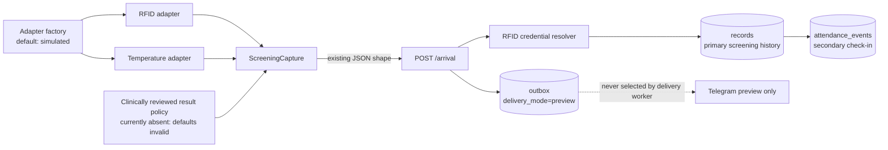

# KidNova hardware integration architecture (prototype plan only)

Status: software architecture and fake-driver tests only. No Raspberry Pi, RFID reader,
temperature sensor, wiring, calibration, or human measurement has been physically tested.
Simulation remains the default, and Telegram delivery remains preview-only.

## Architecture



`arrival/hardware.py` defines a common `read_tag()` / `read_celsius()` boundary.
`ScreeningCapture` combines one valid tag and one valid reading into the existing payload:
`event_id`, `rfid_tag`, `measured_at`, `temperature_c`, and `result`. The existing HTTP,
SQLite, attendance, history, duplicate-event, and preview code remains downstream.

Modes:

| Mode | RFID adapter | Temperature adapter | Selection and behavior |
|---|---|---|---|
| Default | `SimulatedRFIDAdapter` | `SimulatedTemperatureAdapter` | No GPIO or optional imports; queued synthetic values only |
| Explicit prototype | `MFRC522RFIDAdapter` | `MLX90614TemperatureAdapter` | `KIDNOVA_ADAPTER_MODE=raspberry_pi` or explicit factory argument; fails closed if imports/devices are unavailable |

The prototype RFID adapter normalizes a UID as `KN-RFID-HW:MFRC522_<HEX>` before the
existing SHA-256 mapping. A UID is an identifier, not authentication and not a secret;
clone resistance must not be assumed. The default screening policy returns `invalid`,
not `in_range`, until an approved measurement protocol and result policy exist.

## Candidate evaluation

### Raspberry Pi host

- A 40-pin Raspberry Pi is a reasonable Python prototype host because the header exposes
  SPI and I2C. GPIO logic is 3.3 V and is not 5 V tolerant. The official header mapping
  identifies GPIO8/CE0, GPIO11/SCLK, GPIO10/MOSI, GPIO9/MISO and GPIO2/3 for I2C.
- SPI and I2C must be enabled in Raspberry Pi OS. Exact Pi model and OS must be frozen
  before selecting a GPIO library: older MFRC522 packages may depend on `RPi.GPIO`, while
  newer systems—especially Pi 5—need a current backend. The adapter hides that dependency
  from the KidNova database/server code.
- Source: [Raspberry Pi GPIO and header documentation](https://www.raspberrypi.com/documentation/computers/raspberry-pi.html).

### MFRC522-compatible RFID reader candidate

- IC supply: NXP specifies 2.5–3.6 V for the main analog/digital/transmitter supplies,
  with 3.3 V typical. Use a module explicitly documented for 3.3 V logic; do not feed 5 V
  into Raspberry Pi GPIO.
- Interface: SPI is preferred for the prototype. NXP specifies SPI slave operation up to
  10 Mbit/s. The chip also exposes other host interfaces, but this plan does not use them.
- Python candidate: `mfrc522-python` exposes a Raspberry Pi package and declares Python
  3.7+ support. It is a community package, not an NXP or Raspberry Pi supported driver;
  its non-blocking API and GPIO backend must be acceptance-tested on the chosen Pi/OS.
- Constraints: short-range 13.56 MHz tag UID reading is suitable for a bench prototype,
  but UID-only identification is clonable. Antenna position, enclosure material, multiple
  rapid scans and tag type compatibility require physical tests.
- Sources: [NXP MFRC522 datasheet](https://www.nxp.com/docs/en/data-sheet/MFRC522.pdf),
  [`mfrc522-python` package metadata](https://pypi.org/project/mfrc522-python/).

### MLX90614 non-contact IR sensor candidate

- Select the exact 3 V part or a Raspberry-Pi-safe breakout. The 3 V datasheet operating
  range is 2.6–3.6 V (3.0 V typical). Do not assume that every marketplace “GY-906” board
  has the same regulator, pull-ups, optics, or sensor variant.
- Interface: SMBus-compatible two-wire bus, default address `0x5A`, 10–100 kHz. Adafruit’s
  CircuitPython driver supports GNU/Linux/Raspberry Pi and explicitly requires the normal
  100 kHz bus rather than 400 kHz.
- Accuracy: the standard part is specified around ±0.5 °C near room conditions. The
  datasheet describes a special medical variant around ±0.2 °C in a limited body-temperature
  range. These figures require thermal equilibrium and isothermal conditions; heat from the
  Pi, enclosure, nearby electronics, airflow and recent handling can add error. A generic
  module is not thereby a clinical thermometer.
- Field of view: the reading averages all objects in the FOV. The common xAA response is
  approximately 90° between half-response points, while narrower optical variants exist.
  Target distance, spot size, background, alignment and a fixed mechanical guide must be
  validated for the exact suffix. A wide FOV can mix skin, hair, clothing and background.
- Python candidate: `adafruit-circuitpython-mlx90614` exposes object and ambient readings
  on Raspberry Pi. It is optional and is imported only in real mode.
- Sources: [Melexis MLX90614 datasheet](https://www.melexis.com/en/documents/documentation/datasheets/datasheet-mlx90614),
  [Adafruit MLX90614 Python documentation](https://docs.circuitpython.org/projects/mlx90614/en/latest/),
  [Adafruit API notes](https://docs.circuitpython.org/projects/mlx90614/en/latest/api.html).

## Proposed wiring plan

Power off the Pi before wiring. Confirm the module pin labels and exact sensor variant;
clone boards may differ. All devices share ground.

### MFRC522 module to Raspberry Pi 40-pin header (SPI0)

| MFRC522 module | Raspberry Pi signal | Physical pin |
|---|---|---:|
| 3.3V | 3V3 | 1 |
| GND | GND | 6 |
| SDA / NSS / SS | GPIO8 / CE0 | 24 |
| SCK | GPIO11 / SCLK | 23 |
| MOSI | GPIO10 / MOSI | 19 |
| MISO | GPIO9 / MISO | 21 |
| RST | GPIO25 | 22 |
| IRQ | Not connected for initial polling prototype | — |

### MLX90614 3 V part/breakout to Raspberry Pi (I2C1/SMBus)

| MLX90614 | Raspberry Pi signal | Physical pin |
|---|---|---:|
| VDD / VIN | 3V3, only after exact board verification | 17 |
| GND | GND | 9 |
| SDA | GPIO2 / SDA1 | 3 |
| SCL | GPIO3 / SCL1 | 5 |

Raspberry Pi already has 1.8 kΩ pull-ups on GPIO2/3. The Melexis reference circuit shows
pull-ups and a 100 nF local decoupling capacitor. Inspect the breakout first: do not blindly
parallel additional pull-ups, and keep the sensor powered whenever it is connected because
its SDA/SCL pins have clamps to VDD. Keep it physically away from Pi heat and airflow.

## Proposed bill of materials (no prices)

- One Raspberry Pi with 40-pin header and supported Raspberry Pi OS image
- Model-appropriate regulated Raspberry Pi power supply and microSD/storage
- One documented 3.3 V MFRC522-compatible module
- Synthetic/demo-compatible 13.56 MHz tags or cards
- One exact, traceable MLX90614 3 V variant or level-safe breakout
- Female-female jumper wires and a small breadboard/prototyping board
- 100 nF ceramic decoupling capacitor if not present on the MLX90614 breakout
- Non-conductive enclosure plus fixed RFID and IR sensor mounts
- Distance/alignment guide sized after FOV testing
- ESD-safe handling materials and strain relief
- Traceable reference thermometer and a suitable blackbody/reference target for validation
- Optional logic analyser for SPI/I2C troubleshooting

## Failure behavior and test boundary

- Missing optional library or device initialization: `HardwareUnavailableError`; no fallback
  to simulated data and no payload.
- Read-time I/O failure: `DeviceDisconnectedError`; no payload or database change.
- Missing sample: `NoReadingAvailableError`.
- NaN, boolean, string, or values outside 20–50 °C: `InvalidSensorReadingError`. This range
  only rejects broken transport values; it is not a medical normal range.
- Same tag inside the debounce window: `DuplicateScanError`; the second temperature sample
  is not consumed. The server’s existing `event_id` idempotency remains a second layer.
- Failed temperature read does not mark the tag successful, so the same tag can be retried.
- Hardware-originated results still create `delivery_mode=preview`; real Telegram delivery
  is not enabled.

Run software tests without hardware:

```sh
python3 -m unittest test_hardware_adapters test_rfid_simulation -v
```

## Remaining physical integration tasks

1. Select exact Pi model, Raspberry Pi OS release, MFRC522 board and MLX90614 suffix.
2. Review schematics and measure power/logic levels before connecting modules.
3. Enable and verify SPI/I2C; pin optional dependency versions in a separate Pi environment.
4. Bench-test UID stability, tag range, debounce timing, disconnect/reconnect and power loss.
5. Build a fixed IR geometry; characterize distance-to-spot, FOV, ambient drift, warm-up,
   emissivity, enclosure heat and repeatability against a traceable reference/blackbody.
6. Have a qualified clinical/safety reviewer define the measurement procedure and result
   policy. Do not infer disease or core body temperature from an unvalidated surface reading.
7. Threat-model clonable UIDs, provision device credentials, HTTPS and an offline queue.
8. Complete electrical, EMC, enclosure, privacy, consent and operational safety review.
9. Only after separate approval, decide whether any preview may become a real notification;
   the current implementation must remain preview-only.
